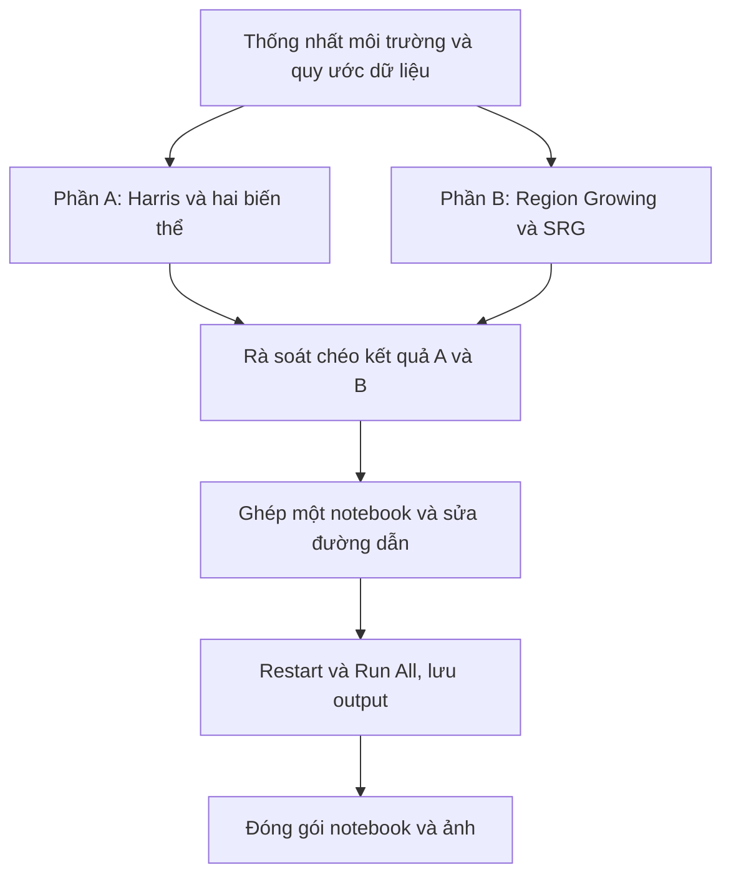
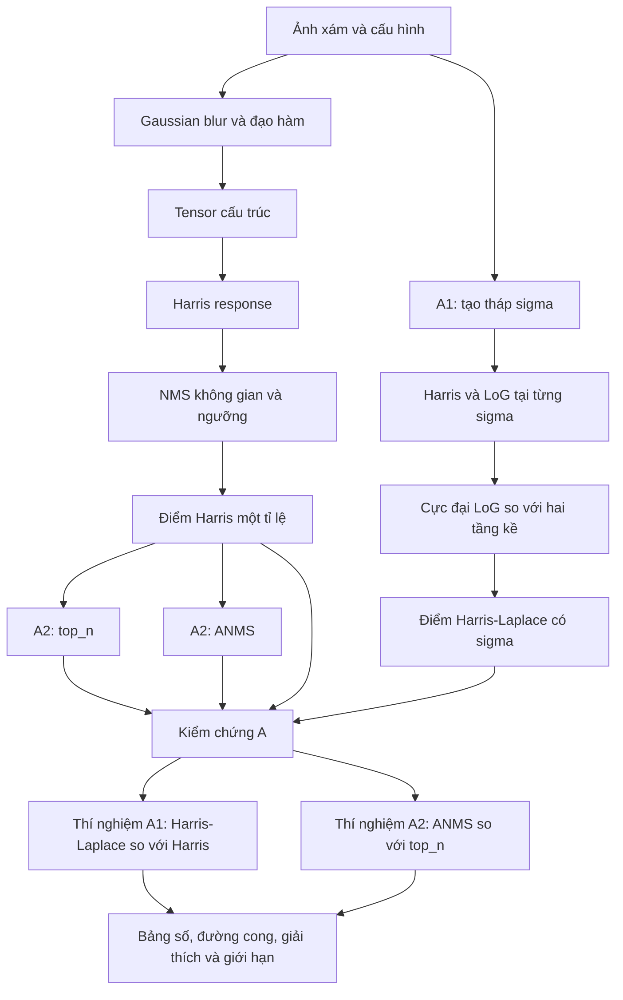
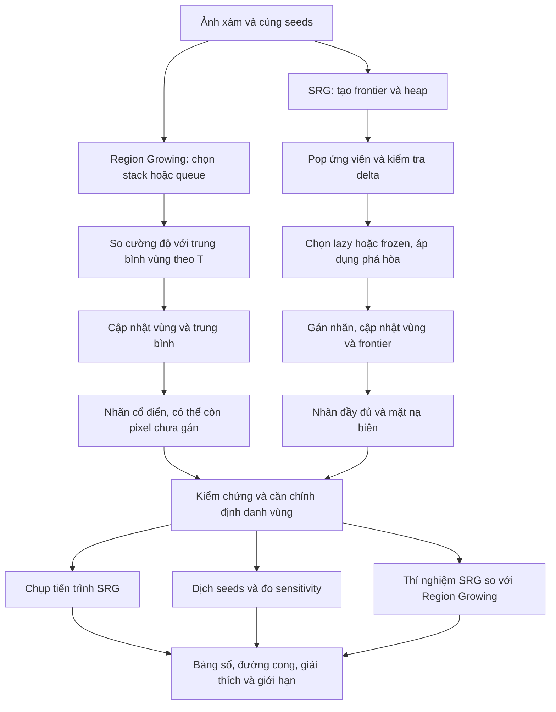

# Pipeline bài tập — Phần A và Phần B

- **Motivation/Background**: Nhóm cần chia bài tập thành các đầu việc có thứ tự, đầu vào và đầu ra rõ ràng để phối hợp trên hai notebook A/B.
- **Purpose**: Hướng dẫn nhóm hoàn thành kiểm chứng, thí nghiệm, phân tích và đóng gói bài nộp.
- **Overview Pipeline**: Chuẩn bị chung → thực hiện A/B song song → kiểm chứng → thí nghiệm → rà soát chéo → ghép notebook → chạy sạch và nộp.
- **Detailed Plan**: §1 Hiện trạng và cách phối hợp; §2 Phần A; §3 Phần B; §4 Thiết kế thí nghiệm; §5 Nghiệm thu và đóng gói.
- **References**: [Đề bài gốc](../../pdf/Computer_Vision%2045.pdf), [README và phân công](../../README.md#nhom-va-phan-cong), [hướng dẫn chi tiết](HUONG_DAN_THUC_HIEN.md), [quy tắc báo cáo](../../agents/rules/RESULTS_REPORTING.md).
- **Created**: 2026-11-11T08:09:23+07:00
- **Last Updated**: 2026-11-11T08:40:11+07:00

---

[STATUS: ACTIVE]

Xem [bản HTML tương tác đầy đủ A/B](PIPELINE_BAI_TAP.html): sơ đồ từng bước, công thức và hợp đồng hàm, tìm kiếm, checklist và bản in offline.

## Mục lục

- [1. Hiện trạng và cách phối hợp](#hien-trang)
- [2. Phần A — Harris và hai biến thể](#phan-a)
- [3. Phần B — Region Growing và SRG](#phan-b)
- [4. Phiếu thiết kế thí nghiệm](#thi-nghiem)
- [5. Nghiệm thu và đóng gói](#nghiem-thu)

---

<a id="hien-trang"></a>

## 1. Hiện trạng và cách phối hợp

Đã có 11 hàm A, 4 hàm B và [bộ kiểm tra tự động](../../tests/). Nhóm tiếp tục từ bước rà soát thuật toán, bổ sung ảnh, chạy các kiểm chứng có hình/số đo, thiết kế thí nghiệm và viết phân tích. Có hàm và chạy được notebook chưa đồng nghĩa hoàn thành bài tập.

| Phần | Nơi làm bài | Ảnh đầu vào | Kết quả cần lưu |
| --- | --- | --- | --- |
| A | [Notebook A](../../notebooks/phan_a_harris_va_hai_bien_the.ipynb) | [Ảnh A](../../images/phan_a/) | [Kết quả A](../../experiments/results/phan_a/) |
| B | [Notebook B](../../notebooks/phan_b_phan_vung_anh.ipynb) | [Ảnh B](../../images/phan_b/) | [Kết quả B](../../experiments/results/phan_b/) |

Thông tin thành viên, MSSV và người phụ trách chỉ cập nhật tại [bảng phân công trong README](../../README.md#nhom-va-phan-cong). Điền mã việc bên dưới vào cột Công việc, kèm trạng thái: Chưa làm / Đang làm / Chờ rà soát / Hoàn thành. Chỉ đánh dấu hoàn thành khi có đủ đầu ra và người khác kiểm tra lại được. Không tự ghi kết quả dự kiến vào bảng số đo.



**Chuẩn bị chung:** dùng Python của môi trường đã cài [requirements](../../requirements.txt); ghi phiên bản, thiết bị, thời điểm và RNG seed khi chạy. Mở notebook với working directory là thư mục chứa notebook. Ảnh A/B dùng đường dẫn tương đối đến các thư mục ảnh trong bảng; miền cường độ và tọa độ `(row, col)` phải nhất quán.

**Cách chia việc:** giao A và B cho hai đầu mối độc lập. Trong A, chia A1 và A2 sau khi thống nhất Harris chung. Trong B, chia việc rà soát Region Growing và SRG từ cùng dữ liệu. Các đầu mối thống nhất cấu hình trước khi ghép bảng so sánh; mỗi notebook chỉ có một người tích hợp tại một thời điểm để tránh xung đột cell/output.

---

<a id="phan-a"></a>

## 2. Phần A — Harris và hai biến thể

**Mục tiêu:** giải thích và chứng minh tác dụng của chọn tỉ lệ bằng Harris–Laplace và chọn điểm phân bố theo ANMS. A1 và A2 là hai nhánh độc lập dùng nền Harris chung.



### Bảng công việc A

| Mã | Phụ thuộc / đầu vào | Công việc | Đầu ra và điều kiện hoàn thành |
| --- | --- | --- | --- |
| A-01 | Chuẩn bị chung; nguồn ảnh | Chọn ảnh; chuẩn bị bàn cờ và các cặp ảnh biến đổi; ghi miền cường độ, ánh xạ tọa độ và cấu hình | Danh sách ảnh có nguồn; cấu hình dùng chung; ánh xạ quay/phóng đúng chiều A sang B |
| A-02 | A-01 | Rà soát `gaussian_blur`, `structure_tensor`, `harris_response`, `nms_2d`, `harris_classic`; giải thích sigma đạo hàm và sigma tích phân | Hình điểm Harris; giải thích tensor đã nhân `sigma_d**2`, NMS và ngưỡng; kiểm chứng bàn cờ đạt trước khi chốt nền chung |
| A-03 | A-02 | Nhánh A1: rà soát `scale_pyramid`, `log_normalized`, `harris_laplace`; chọn tỉ lệ bằng cực đại LoG | Điểm `(row, col, sigma, response)`; hình thể hiện sigma; kiểm tra ứng viên chỉ được giữ khi LoG vượt cả hai tầng kề |
| A-04 | A-02 | Nhánh A2: rà soát `top_n` và `anms` trên cùng ứng viên Harris một tỉ lệ; lấy mã hoặc xác nhận định nghĩa `grid_occupancy` | Hai tập điểm cùng N, cùng lưới; nguồn/định nghĩa phép đo độ phủ được ghi rõ trước khi đo |
| A-05 | A-02, A-03, A-04; hàm `repeatability` | Hoàn thành năm kiểm chứng trong bảng dưới | Mỗi kiểm chứng có cấu hình, hình, số đo và nhận xét; chỉ chuyển thí nghiệm liên quan khi kiểm chứng đã đạt |
| A-06 | A-05; hai phiếu thiết kế A1/A2 đã chốt | Chạy hai cặp thí nghiệm, quét tham số và giải thích cơ chế | Mỗi cặp có ít nhất một phép đo, hình khác biệt, bảng số gốc, đường cong, giải thích và giới hạn |

**Điểm cần chốt ở A-04:** đề nhắc `grid_occupancy` là hàm cho sẵn, nhưng tài liệu hiện có chưa cung cấp mã/chữ ký. Lấy bản giảng viên hoặc xác nhận định nghĩa lưới trước khi công bố số đo; không tự coi một định nghĩa mới là bản chuẩn của đề.

### Năm kiểm chứng A

| Kiểm chứng | Cần làm | Bằng chứng cần lưu |
| --- | --- | --- |
| Bàn cờ tổng hợp | Đối chiếu điểm phát hiện với giao điểm đã biết | Hình giao điểm, sai số vị trí và kết luận theo yêu cầu ≤ 1 px |
| Quay 30° | Đo repeatability với ánh xạ tọa độ quay chính xác | Cặp ảnh, số điểm hợp lệ, repeatability và quy ước ghép |
| Phóng 3× | So Harris với Harris–Laplace trên cùng cặp ảnh | Hai repeatability, số điểm hợp lệ và hình đối chiếu |
| Đối chiếu OpenCV | Dùng hàm dựng sẵn ở phần kiểm chứng, ghi cấu hình khác biệt | Hình và mức khớp trong bán kính 2–3 px |
| ANMS và `top_n` | Giữ cùng ứng viên, N và định nghĩa lưới | Hai hình phân bố điểm và hai giá trị độ phủ |

### Thí nghiệm A cần bàn giao

- **A1/Harris:** cùng cặp ảnh, ánh xạ, `eps` và quy tắc ghép. Hướng quét gợi ý: `xi`, số tầng hoặc `log_thresh`; theo dõi repeatability và/hoặc tỷ lệ ứng viên bị loại. Nhóm chọn một trục chính và tập giá trị trước khi chạy.
- **ANMS/`top_n`:** cùng ứng viên Harris một tỉ lệ, cùng N và lưới độ phủ. Hướng quét gợi ý: `c_robust` trong khoảng 0.5–1.0 hoặc N; giải thích ảnh hưởng của bán kính triệt tiêu đến phân bố điểm.

**Checklist A:**

- [ ] Rà soát đủ 11 hàm và hiểu định dạng đầu ra.
- [ ] Đủ năm kiểm chứng với hình và số đo.
- [ ] Đủ hai cặp thí nghiệm A1 và A2; mỗi cặp có bảng số, đường cong, cơ chế và giới hạn.
- [ ] Kết quả được lưu trong notebook và thư mục kết quả A; ảnh có nguồn.

---

<a id="phan-b"></a>

## 3. Phần B — Region Growing và SRG

**Mục tiêu:** đối chiếu phát triển vùng theo ngưỡng/thứ tự duyệt với phát triển đồng thời theo độ ưu tiên; làm rõ ảnh hưởng trung bình vùng, delta cũ, phá hòa và vị trí seeds.



### Bảng công việc B

| Mã | Phụ thuộc / đầu vào | Công việc | Đầu ra và điều kiện hoàn thành |
| --- | --- | --- | --- |
| B-01 | Chuẩn bị chung; nguồn ảnh | Chọn ảnh, seeds hợp lệ; ghi định danh vùng, thứ tự lân cận, miền cường độ và T | Ảnh và danh sách seeds tái lập; cùng một cấu hình đầu vào cho các phương pháp |
| B-02 | B-01 | Rà soát `region_growing_classic`: stack/queue, ngưỡng so với trung bình và cập nhật vùng | Hai ảnh nhãn, thể hiện `-1` bằng màu riêng; giải thích thứ tự duyệt có thể làm đổi kết quả |
| B-03 | B-01 | Rà soát `srg`: heap, chọn vùng, delta, cập nhật và mặt nạ biên; kiểm tra lazy/frozen và ba cách phá hòa | Nhãn `int32` đầy đủ, biên bool; mô tả rõ cường độ seed so với trung bình vùng và quy tắc phá hòa |
| B-04 | B-02, B-03 | Hoàn thành năm kiểm chứng dưới đây; đối chiếu lazy/frozen và insertion/raster/random | Hình, số pixel khác sau căn chỉnh nhãn; ít nhất một ảnh cho thấy đổi phá hòa làm đổi phân vùng |
| B-05 | B-04 | Dùng `srg_step_frames` và `seed_sensitivity`; ghi các mốc và quy tắc dịch seeds | Chuỗi frame độc lập, frame cuối khớp SRG; bản đồ tần suất đổi vùng trong [0,1], có cấu hình và RNG seed |
| B-06 | B-04, B-05; phiếu thiết kế B đã chốt | So SRG với Region Growing, quét tham số, giải thích và tổng hợp | Hình khác biệt, bảng số gốc, đường cong, cơ chế và giới hạn; có phần so lazy/frozen và phá hòa |

### Năm kiểm chứng B

| Kiểm chứng | Cần làm | Bằng chứng cần lưu |
| --- | --- | --- |
| Phân hoạch đầy đủ | Kiểm tra mọi pixel SRG được gán nhãn, kể cả pixel biên | Số pixel chưa gán bằng 0 và hình nhãn |
| Bảo toàn số vùng | So số nhãn với số seeds hợp lệ, không trùng | Hai số bằng nhau; seed giữ đúng vùng |
| Đảo thứ tự seeds | Chạy lại và căn chỉnh nhãn theo cùng định danh seed | Hai hình và số pixel thực sự đổi vùng; giải thích ảnh hưởng của thứ tự chèn nếu có |
| Stack / queue / SRG | Dùng cùng ảnh và seeds, ghi T cho phương pháp cổ điển | Các hình và số pixel khác từng cặp, thể hiện riêng pixel chưa gán |
| Ảnh phẳng, hai seeds | So insertion/raster/random; cố định RNG seed khi dùng random | Hình dạng vùng và số pixel thay đổi; có ít nhất một trường hợp phân vùng khác khi đổi quy tắc |

**Căn chỉnh nhãn:** cùng một vùng đổi từ mã 0 sang mã 1 chưa phải đổi phân vùng. Quy mã về cùng seed trước khi đếm pixel khác và khi tính sensitivity. Pixel chưa gán của Region Growing vẫn là một trạng thái riêng.

**Frames và sensitivity:** ghi số frame/mốc tiến trình; số trial, jitter, RNG seed, cách tránh seeds ngoài ảnh/trùng nhau và cách chuẩn hóa nhãn. Đọc docstring hiện có trước khi dùng; bản đồ sensitivity là tần suất đổi so với phân vùng gốc, không phải nhãn vùng mới.

### Thí nghiệm B cần bàn giao

Giữ cùng ảnh và seeds khi so SRG với Region Growing. Hướng quét gợi ý: T, số/vị trí seeds hoặc connectivity 4/8 cho SRG. Chọn phép đo phù hợp, chẳng hạn tỷ lệ pixel được gán, tỷ lệ diện tích vùng lớn nhất hoặc seed sensitivity; ghi rõ mẫu số và xử lý `-1`. Không so số vùng trên cùng seeds như đại lượng chính nếu nó luôn được cố định bởi cách khởi tạo. Bố trí riêng đối chiếu lazy/frozen và phá hòa, kể cả khi trục quét chính là T.

**Checklist B:**

- [ ] Rà soát đủ bốn hàm, bảo toàn định danh seed và hiểu mặt nạ biên.
- [ ] Đủ năm kiểm chứng và bằng chứng khác biệt lazy/frozen, phá hòa.
- [ ] Có chuỗi tiến trình và bản đồ seed sensitivity tái lập.
- [ ] Cặp SRG/Region Growing có bảng số, đường cong, cơ chế và giới hạn.
- [ ] Kết quả được lưu trong notebook và thư mục kết quả B; ảnh có nguồn.

---

<a id="thi-nghiem"></a>

## 4. Phiếu thiết kế thí nghiệm

Điền riêng một phiếu cho mỗi cặp **Harris–Laplace/Harris**, **ANMS/`top_n`**, **SRG/Region Growing** trong notebook tương ứng. Các hướng quét ở trên là gợi ý; nhóm chốt lựa chọn trước khi chạy và không dùng dự đoán làm kết quả đo.

| Trường cần chốt | Nội dung nhóm điền |
| --- | --- |
| Câu hỏi và giả thuyết | Hiện tượng muốn khảo sát và dự đoán cơ chế |
| Ảnh và nguồn | Ảnh nào, lý do chọn, biến đổi/chỉnh sửa, kích thước, miền cường độ |
| Biến quét | Một trục chính, tập giá trị đủ để vẽ xu hướng hoặc điểm chuyển hành vi |
| Yếu tố cố định | Tiền xử lý, các tham số khác, seeds, ánh xạ, phép ghép/đếm |
| Phép đo | Công thức, đơn vị, mẫu số, quy tắc nhãn/điểm hợp lệ và trường hợp rỗng |
| Tái lập | RNG seed, số lần lặp và cách tổng hợp khi có ngẫu nhiên |
| Bằng chứng | Hình đối chiếu, bảng số từng lần chạy, đường cong có tên trục/đơn vị/chú giải |

Sau khi chạy, mỗi cặp trình bày: **câu hỏi → cấu hình → hình/bảng/đường cong → giải thích → giới hạn**. Trả lời cụ thể đại lượng nào đổi, ở bước tính nào và vì sao gây ra hiện tượng quan sát. Báo cả trường hợp không khớp giả thuyết.

Theo [quy tắc báo cáo](../../agents/rules/RESULTS_REPORTING.md), mỗi số đo cần đủ ngữ cảnh: đại lượng/đơn vị, câu hỏi, thời điểm/lần chạy, ảnh và vị trí kết quả, cấu hình/người thực hiện, cách tính/tham số/lặp. Việc ghi người thực hiện tham chiếu [phân công chung](../../README.md#nhom-va-phan-cong).

---

<a id="nghiem-thu"></a>

## 5. Nghiệm thu và đóng gói

1. **Rà soát chéo:** người phụ trách A kiểm tra lại cấu hình và bằng chứng B; người phụ trách B kiểm tra lại A. Nếu nhóm chỉ có một người, dùng cùng checklist để tự rà soát sau khi chạy sạch.
2. **Chạy kiểm tra tự động:** từ thư mục gốc, chạy các lệnh dưới đây. Các kiểm tra này hỗ trợ phát hiện lỗi, không thay các kiểm chứng có output trong notebook.

   ```powershell
   .\.venv\Scripts\python.exe -m unittest discover -s tests -v
   .\.venv\Scripts\python.exe -m pip check
   ```

3. **Ghép bài:** ghép nội dung A/B thành một notebook, giữ định nghĩa trước nơi gọi, giữ tên hàm và thứ tự dữ liệu; kiểm tra không xung đột import/hàm hỗ trợ.
4. **Kiểm tra đường dẫn:** dùng đường dẫn tương đối theo vị trí notebook cuối, kèm đủ ảnh đầu vào. Đề hiện ghi tên notebook `bt1_<Nhom>.ipynb`; nhóm xác nhận với giảng viên nếu cần đổi tên.
5. **Chạy sạch:** Restart & Run All toàn bộ notebook đã ghép; kiểm tra không traceback, đủ hình/bảng/kết luận rồi lưu cả output.
6. **Thử gói nộp:** sao chép notebook và ảnh sang thư mục khác, kiểm tra các tài nguyên và khả năng chạy lại. Đối chiếu [checklist nộp bài trong hướng dẫn](HUONG_DAN_THUC_HIEN.md#8-kiểm-tra-cuối-và-nộp-bài), gồm các quy định của đề về thư viện và sử dụng AI.

**Điều kiện hoàn thành toàn bài:**

- [ ] Đủ 11 hàm A và 4 hàm B đúng chữ ký, hiểu và kiểm tra được cách hoạt động.
- [ ] Đủ năm kiểm chứng A và năm kiểm chứng B có hình/số đo thực tế.
- [ ] Đủ ba cặp thí nghiệm, mỗi cặp có bằng chứng, bảng số gốc, đường cong, cơ chế và giới hạn.
- [ ] Có lazy/frozen, phá hòa, frames và seed sensitivity.
- [ ] Thông tin nhóm/phân công đã điền trong README; môi trường và nguồn ảnh đầy đủ.
- [ ] Một notebook cuối chạy sạch, đã lưu output, ảnh đi kèm và đường dẫn tương đối hoạt động.
